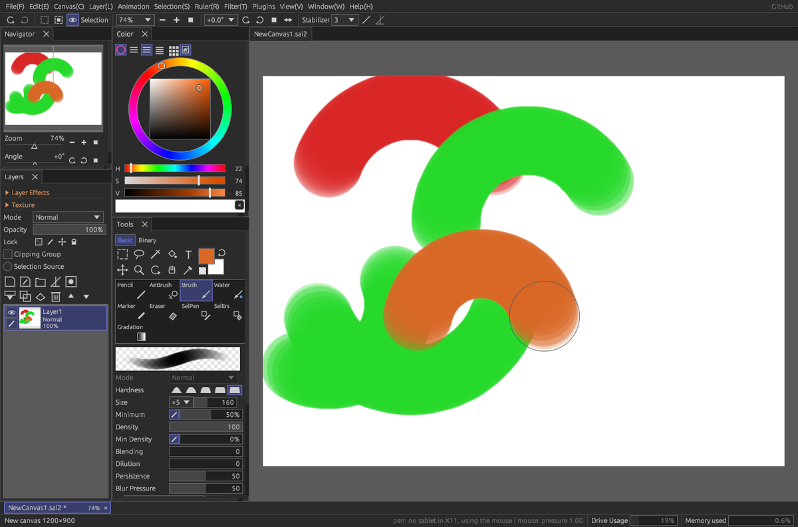

# GrazySAI

**English** | [Русский](README.ru.md)

**A free painting program for drawing and animation, with a feel and a brush engine modelled
on PaintTool SAI 2.** It runs on Windows and Linux (and FreeBSD), works with graphics tablets and opens
`.sai2` files. Version 1.4.5.



## Try it in a minute

1. Open the [**Releases**](https://github.com/grazyping/GrazySAI/releases/latest) page and download the archive for your system.
2. Unpack it and run the program. Nothing needs to be installed.
   - **Windows**: `GrazySAI-…-windows-x86_64.zip` → `GrazySAI.exe` (Windows 7 and 8 have their own archive).
   - **Linux**: `GrazySAI-…-linux-x86_64.tar.gz` → `./GrazySAI`.
   - **FreeBSD**: a `.pkg` package or an archive.
3. Draw. To open a drawing, drop the file onto the window.

The program updates itself from GitHub: a quiet notice appears in the menu bar when a new version is out.
The interface speaks 10 languages and picks yours automatically.

## What you can do

**Paint**
- Brushes that behave like SAI's: pencil, airbrush, brush, watercolor, marker, eraser. They
  mix paint with the canvas — blending, dilution, persistence. A stabilizer for smooth lines.
- Layers with folders, clipping, masks, all 28 blend modes, paper texture, layer effects
  (Fringe, Binary Color) and layer styles (stroke, shadow, glow).
- Selections (rectangle, lasso, magic wand), transformation, bucket fill, filters, rulers
  (line, ellipse), curves and shapes on linework layers, text layers.
- A library of brushes with your own shapes and textures; brushes from SAI 2, Photoshop, Krita
  and Clip Studio can be imported. A separate **brush workshop** program (`GrazySAI-Studio`)
  helps to design brushes and plugins.

**Animate**
- A timeline with animation folders and cels, onion skin, playback, and export to GIF, APNG,
  PNG frames and MP4.
- **Puppet** animation like After Effects: pin a picture and drag it, the whole mesh follows.
  Pins get keys on the timeline.

**Work with 3D**
- 3D layers from glTF, VRM, OBJ, FBX, PMX and COLLADA models, with poses, camera and
  conversion to lines for tracing.

**Make the window yours**
- Panels that dock like in Clip Studio (“Window → Dockable panels”), workspaces,
  command search (Ctrl+Shift+P), a quick-access bar, your own shortcuts and pen buttons,
  auto actions (record a sequence of commands and replay it with one button).

**Exchange files**
- Reads and writes `.sai2` (SAI 2 opens these files too), PSD and PSB with layers,
  OpenRaster, PNG, JPEG, WebP, TIFF, BMP, TGA and QOI.
- **GrazySAI Convert** (`GrazySAI-Convert`) converts whole batches of pictures and 3D models
  from one format to another.

**Tablets**: pen pressure, tilt and rotation work on Linux (XInput 2) and Windows (Windows Ink,
WinTab). A virtual pen and tablet are included for testing without hardware.

## Learn more

- [**Manual**](docs/manual.en.md) — how to use everything above.
- [**Roadmap**](ROADMAP.en.md) — what is done and what comes next, and the
  [Milestones](https://github.com/grazyping/GrazySAI/milestones) tab.
- Found a bug or want a feature? Open an [issue](https://github.com/grazyping/GrazySAI/issues).
  A short description and, if you can, the file that shows the problem help most.
- Translations are plain text files in `crates/paint-app/lang/` (see below).

The documents in `docs/` other than the manual are written in Russian.

## Building from source

```bash
cargo build --release -p paint-app      # editor: target/release/GrazySAI [file.sai2]
cargo build --release -p paint-studio   # brush workshop
cargo build --release -p paint-convert  # converter
cargo build --release -p paint-cli      # command line: comparisons, rendering, .sai2 inspection
cargo test --workspace --release
```

Windows build from Linux: target `x86_64-pc-windows-gnullvm`, linker llvm-mingw (path in
`.cargo/config.toml` — adjust it for your machine).

Tests that use the author's sample files look for them in `~/SAI2` (or in `SAI2_SAMPLES`); if
the files are missing, those tests are skipped.

## Translations

Each language is a plain text file `crates/paint-app/lang/<code>.txt` with lines
`Russian source text = translation`; `{0}`, `{1}` are values inserted by the program. The test
`every_key_is_translated` (`cargo test -p paint-app`) checks that every interface string has a
translation in every file. Corrections and new languages are welcome as pull requests.

## Project layout

| Directory | What |
|---|---|
| `crates/paint-core` | Pixels, tiles, layers, blending, brush engine, strokes, vector shapes, resampling, animation, puppet |
| `crates/paint-formats` | `.sai2`, PSD, OpenRaster and image reading and writing; the shared format table |
| `crates/paint-app` | The editor window (egui), translations in `lang/` |
| `crates/paint-3d` | 3D models: reading, poses, rendering, export to GLB and OBJ |
| `crates/paint-studio` | Brush and plugin workshop |
| `crates/paint-convert` | Batch converter |
| `crates/paint-cli` | Command line for comparisons with the reference program |
| `crates/pen-test` | Pen event logger (Windows Ink, WinTab, XInput 2) |
| `crates/virtual-tablet` | Virtual tablet via `/dev/uinput` (Linux) |
| `docs/` | Plan, `.sai2` format, the rules of the program in our own words, comparisons, interface |
| `tools/` | Release, checks on a hidden display, virtual pen |

## About the name and the license

GrazySAI was called **SOsai** before version 0.8.42; older versions update to GrazySAI by themselves.

MIT — see [LICENSE](LICENSE). GrazySAI is an independent project and is not affiliated with
SYSTEMAX Software Development, the author of PaintTool SAI; the names SAI and PaintTool SAI
belong to their owner. The code is written from scratch based on the program's observed
behaviour and file format; there is no PaintTool SAI code in this repository.
